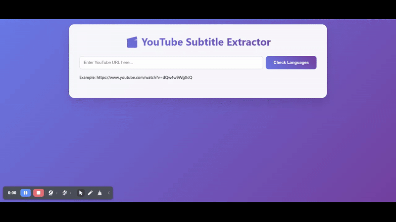

# YouTube KeyPoints Extractor

A full-stack Flask application that extracts subtitles from YouTube videos and generates structured, AI-powered key points and summaries.

## Preview



## Features

- 🎬 **Transcript Extraction**: Extract subtitles from any YouTube video with available transcripts.
- 🔗 **Shareable Links**: Auto-fills and processes videos via URL query parameters (e.g., `?url=https://youtu.be/...`).
- 🌐 **Language Selection**: Choose from available subtitle languages with detailed metadata.
- 🔍 **Language Detection**: Automatically detect all available subtitle languages (manual vs. auto-generated).
- 🧠 **AI-Powered Summarization**: Generate key insights using Groq or Google AI Studio models.
- ✂️ **Smart Chunking**: Automatically breaks down long transcripts to bypass AI token limits and ensure comprehensive, high-quality summaries.
- 🎨 **Modern UI**: Responsive web interface with glassmorphism design and smooth animations.
- 📋 **One-Click Copy**: Easily copy transcripts and generated key points to the clipboard.
- 📥 **Export Results**: Download the transcript and generated key points together as a TXT or Markdown file.
- 🚀 **RESTful API**: Clean and well-documented API endpoints for easy integration.

## AI Models Available

- **Groq - GPT-OSS 20B**: Faster processing for quick key point generation.
- **Groq - GPT-OSS 120B**: More capable analysis for detailed, complex insights.
- **Google AI Studio - Gemini 3.8 Flash**: Fast, efficient responses.
- **Google AI Studio - Gemini 3.1 Pro Preview**: Advanced reasoning for highly detailed summaries.

## Setup Instructions

### 1. Install Dependencies

```bash
pip install -r requirements.txt
```

Or install manually:
```bash
pip install Flask youtube-transcript-api python-dotenv requests
```

### 2. Environment Setup

Create a `.env` file in the project root:
```env
GROQ_API_KEY=your_groq_api_key_here
GOOGLE_AI_STUDIO_API_KEY=your_google_ai_studio_api_key_here
```

- Get your Groq API key from: https://console.groq.com/
- Get your Google AI Studio API key from: https://aistudio.google.com/apikey

### 3. Project Structure

Ensure the following directory structure:
```text
youtube-keypoints-extractor/
├── app.py
├── requirements.txt
├── .env
├── templates/
│   └── index.html
└── static/ (auto-created)
```

### 4. Run the Application

```bash
python app.py
```

The application will be available at: `http://localhost:5000`

## Usage

### Web Interface
1. Open your browser and go to `http://localhost:5000`.
2. Enter a YouTube URL in the input field *(or append `?url=YOUTUBE_LINK` to the address bar to auto-load)*.
3. Click **"Check Languages"** to see available subtitle languages.
4. Select your preferred language from the interactive grid.
5. Click **"Extract Subtitles"** to retrieve the transcript.
6. Choose an AI model, target output language, and toggle **Chunking** (recommended for long videos).
7. Click **"Generate Key Points"** and copy the results as needed, or download the transcript and key points together as a TXT or Markdown file.
8. Open **"Riwayat Lokal"** to search, reopen, and delete saved transcripts and key points.

💡 *Pro Tip:* The browser URL automatically updates with the `?url=` parameter upon extraction, making it easy to bookmark or share your current session.

### Riwayat Lokal

Transcript and generated key points are saved in the application's SQLite database (`instance/history.sqlite3`). Open `/history` or click **"Riwayat Lokal"** to search and filter by date, language, and key points status. Results are paginated (10, 20, or 50 entries per page); click a title to read the transcript and formatted key points, or delete an entry. Existing browser-local history is imported automatically on the first visit and kept in the browser as a backup. Back up `instance/history.sqlite3` regularly; deleting the database file or the application's instance directory removes server history.

### API Endpoints

#### Get Available Languages
**POST** `/api/languages`

**Request body:**
```json
{
    "url": "https://www.youtube.com/watch?v=VIDEO_ID"
}
```

**Response:**
```json
{
    "video_id": "VIDEO_ID",
    "languages": [
        {
            "language_code": "en",
            "language": "English",
            "is_generated": true,
            "is_translatable": true
        }
    ],
    "success": true
}
```

#### Extract Transcript
**POST** `/api/transcript`

**Request body:**
```json
{
    "url": "https://www.youtube.com/watch?v=VIDEO_ID",
    "language_code": "en"
}
```

**Response:**
```json
{
    "video_id": "VIDEO_ID",
    "video_title": "Actual Video Title Here",
    "transcript": "Full transcript text...",
    "language_code": "en",
    "success": true
}
```

#### Generate Key Points
**POST** `/api/keypoints`

**Request body:**
```json
{
    "transcript": "Full transcript text...",
    "provider": "google",
    "model": "gemini-3.8-flash",
    "target_language": "Indonesia",
    "use_chunking": true
}
```
*Note: `target_language` defaults to "Indonesia". `use_chunking` defaults to `true` and is highly recommended for transcripts longer than 6000 characters.*

**Response:**
```json
{
    "key_points": "Generated key points in markdown format...",
    "provider": "google",
    "model": "gemini-3.8-flash",
    "success": true
}
```

#### Health Check
**GET** `/api/health`

**Response:**
```json
{
    "status": "healthy"
}
```

## Supported URL Formats

- `https://www.youtube.com/watch?v=VIDEO_ID`
- `https://youtu.be/VIDEO_ID`
- `https://www.youtube.com/embed/VIDEO_ID`
- `https://www.youtube.com/shorts/VIDEO_ID`

## AI-Powered Key Points & Chunking

The application intelligently handles long videos to prevent AI token limit errors:
1. **Detection**: If the transcript exceeds 6000 characters and chunking is enabled, it splits the text into manageable blocks.
2. **Parallel/Sequential Summarization**: Each block is summarized individually with a slight delay to respect API rate limits.
3. **Final Synthesis**: A final AI prompt merges all chunk summaries into one cohesive, structured, and non-repetitive output.

## UI/UX Features

- **Glassmorphism Design**: Modern aesthetic with backdrop blur and gradient accents.
- **Interactive Language Grid**: Visual badges indicating "Auto-generated" or "Translatable" subtitles.
- **Markdown Rendering**: AI outputs are beautifully rendered into HTML (supporting lists, bold text, and tables) using `marked.js`.
- **SweetAlert2 Integration**: Elegant toast notifications for success and error states.

## Error Handling

Comprehensive error handling for:
- Invalid or unsupported YouTube URLs.
- Videos without available transcripts/subtitles.
- Private, deleted, or age-restricted videos.
- Missing or invalid API keys.
- AI Provider rate limits or timeouts.

## Notes

- Successful subtitle extractions are recorded in `submissions.log` as JSON Lines (URL, video title, video ID, and UTC timestamp).
- Transcript history and generated key points are stored in `instance/history.sqlite3`; this local SQLite database is not committed to version control.
- The transcript is returned as plain text without timestamps for cleaner AI processing.
- No video data is stored on the server.

## Contributing

Feel free to submit issues, fork the repository, and create pull requests for enhancements!

## License

This project is open source and available under the [MIT License](LICENSE).